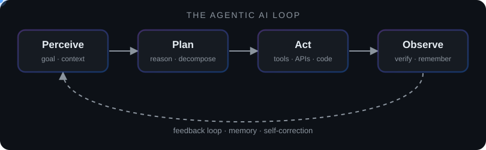

<!-- Remplace TON_LINKEDIN par ton identifiant LinkedIn -->

<p align="center">
  
</p>

<p align="center">
  
</p>

<p align="center">
  
  
  <a href="https://www.linkedin.com/in/TON_LINKEDIN"></a>
</p>

## About

Master's student in Data Science and Artificial Intelligence, focused on **generative AI** and **agentic systems**: LLM applications, retrieval-augmented generation, and agents that plan, use tools and verify their own work. I also teach data science and enjoy turning complex ideas into clear, hands-on material.

<p align="center">
  
</p>

## Areas of work

| Generative AI | Agentic AI |
|---|---|
| LLM-powered applications | Agents that plan, act and observe |
| Retrieval-augmented generation (RAG) | Tool use and function calling |
| Prompt design and structured outputs | Multi-agent workflows |
| Generative models (autoencoders, GANs) | Memory, guardrails and evaluation |

## Reference architecture

```mermaid
flowchart LR
    U([User request]) --> P[Planner LLM]
    P --> T{Tool router}
    T -->|search| R[(Vector store / RAG)]
    T -->|code| C[Code executor]
    T -->|API| A[External APIs]
    R --> M[Memory]
    C --> M
    A --> M
    M --> P
    P --> O([Answer + sources])
