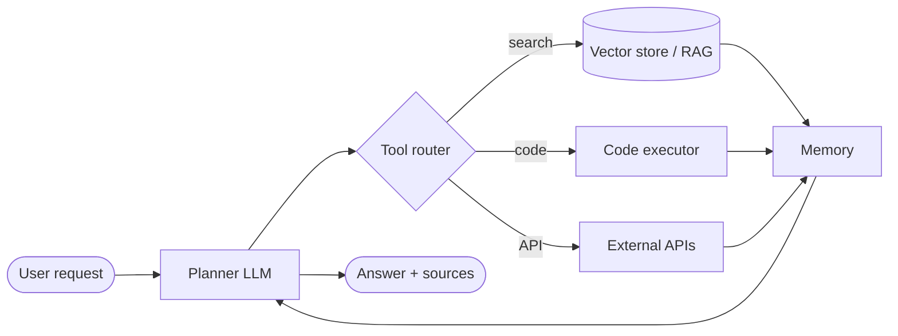

<!-- Remplace TON_USERNAME et TON_LINKEDIN partout -->

  

  

  
  
  
  

## 👩‍💻 About me

- 🎓 Master's student in **Data Science & Artificial Intelligence**
- 🤖 Passionate about **generative AI** and **agentic systems**: LLM apps, RAG pipelines, tool-using agents
- 🧑‍🏫 I also teach data science and love turning complex ideas into clear, hands-on material
- 🌱 Currently exploring: agent orchestration, evaluation of LLM systems, multi-agent collaboration

  

## 🧠 What I build

| 🎨 Generative AI | 🕹️ Agentic AI |
|---|---|
| LLM-powered applications | Agents that plan, act and observe |
| Retrieval-Augmented Generation (RAG) | Tool use & function calling |
| Prompt engineering & structured outputs | Multi-agent workflows |
| GANs & generative models | Memory, guardrails & evaluation |

## 🏗️ A typical agent architecture

## 🛠️ Tech stack

  
  
  
  
  
  
  
  
  

## 📌 Featured projects

<!-- Garde uniquement les repos qui existent vraiment et sont publics -->

| Project | Description | Stack |
|---|---|---|
| [MOM Generator](https://github.com/TON_USERNAME/mom-generator) | LLM assistant that turns meeting recordings into structured minutes | Python, LLM, speech-to-text |
| [GAN Playground](https://github.com/TON_USERNAME/gan-mnist) | Autoencoder and GAN trained on MNIST, with generated samples | PyTorch |
| [Agent Project #1](https://github.com/TON_USERNAME/agent-project-1) | Tool-using agent with planning and memory | LangGraph, Python |
| [Agent Project #2](https://github.com/TON_USERNAME/agent-project-2) | Multi-agent workflow with evaluation | Python |

## 📊 Activity

  
  

  

  

## 🐍 Contribution snake

  

  

